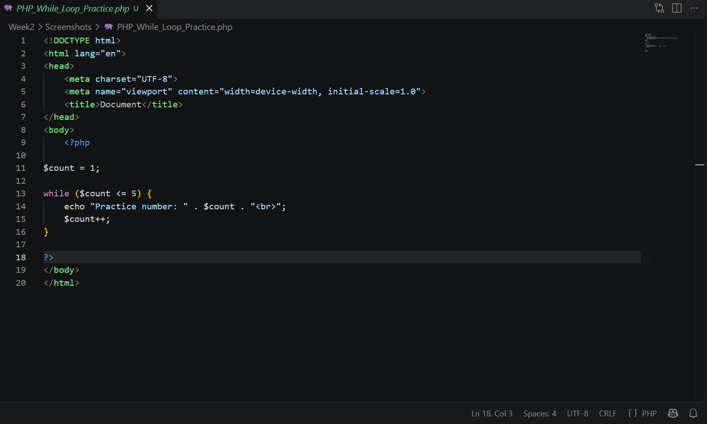
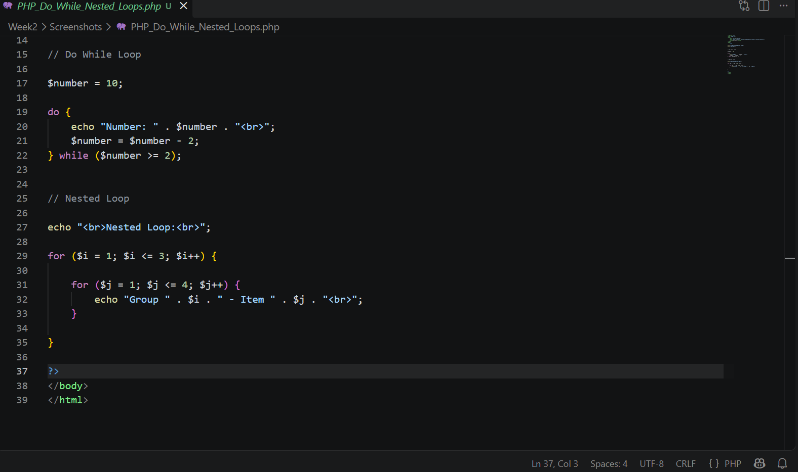
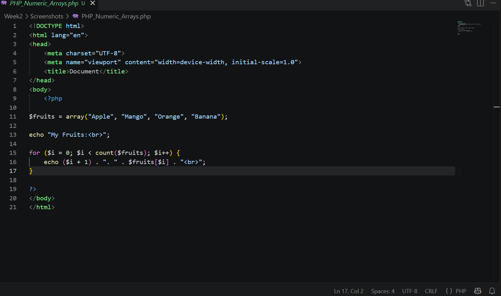
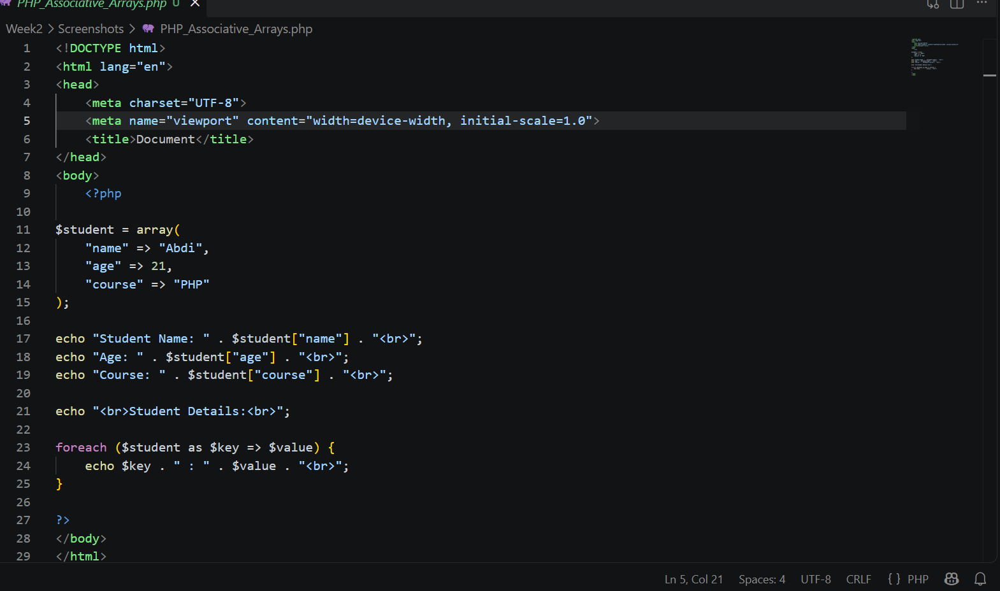
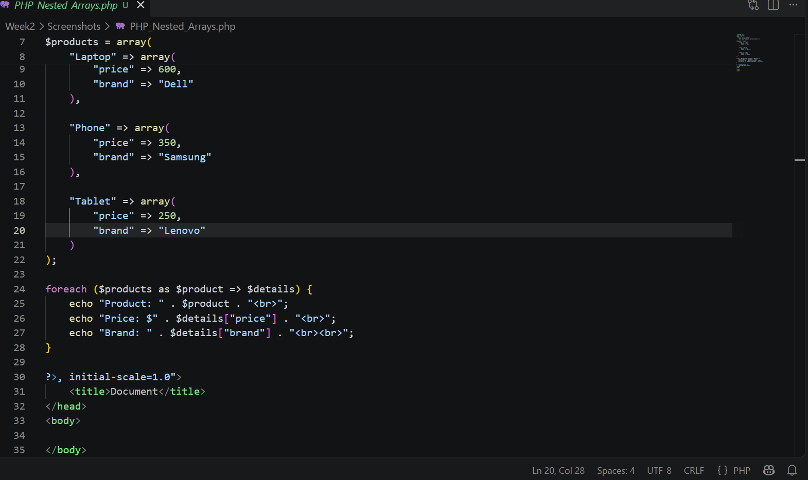

# Week 2: Loops and Arrays

This folder contains my Week 2 practice screenshots demonstrating loops and arrays in PHP from the course **Web Application Development - PHP & MySQL**.

# Week 2 Practice Screenshots

The screenshots below document the main examples in the PHP practice files of this folder (`PHP_While_Loop_Practice.php`, `PHP_Do_While_Nested_Loops.php`, `PHP_Numeric_Arrays.php`, `PHP_Associative_Arrays.php`, and `PHP_Nested_Arrays.php`).

---

# 1. While Loop

## Screenshot Name

`PHP_While_Loop_Practice.png`

## Description

This screenshot shows a `while` loop that starts at 1 and prints "Practice number" followed by the current value until the counter reaches 5.

### Code Example

```php
$count = 1;

while ($count <= 5) {
    echo "Practice number: " . $count . "<br>";
    $count++;
}
```

## Screenshot



---

# 2. Do-While and Nested Loops

## Screenshot Name

`PHP_Do_While_Nested_Loops.png`

## Description

This screenshot demonstrates a `do while` loop that counts down from 10 in steps of 2, and nested `for` loops that print 3 groups with 4 items each.

### Code Example

```php
$number = 10;

do {
    echo "Number: " . $number . "<br>";
    $number = $number - 2;
} while ($number >= 2);

for ($i = 1; $i <= 3; $i++) {
    for ($j = 1; $j <= 4; $j++) {
        echo "Group " . $i . " - Item " . $j . "<br>";
    }
}
```

## Screenshot



---

# 3. Numeric Arrays

## Screenshot Name

`PHP_Numeric_Arrays.png`

## Description

This screenshot demonstrates creating a numeric array of fruits and looping through it with a `for` loop and the `count()` function, printing each item with a numbered list.

### Code Example

```php
$fruits = array("Apple", "Mango", "Orange", "Banana");

echo "My Fruits:<br>";

for ($i = 0; $i < count($fruits); $i++) {
    echo ($i + 1) . ". " . $fruits[$i] . "<br>";
}
```

## Screenshot



---

# 4. Associative Arrays

## Screenshot Name

`PHP_Associative_Arrays.png`

## Description

This screenshot demonstrates an associative array with a student's name, age, and course, accessing values by key, and looping through all key-value pairs with `foreach`.

### Code Example

```php
$student = array(
    "name" => "Abdi",
    "age" => 21,
    "course" => "PHP"
);

echo "Student Name: " . $student["name"] . "<br>";

foreach ($student as $key => $value) {
    echo $key . " : " . $value . "<br>";
}
```

## Screenshot



---

# 5. Nested Arrays

## Screenshot Name

`PHP_Nested_Arrays.png`

## Description

This screenshot shows a `$products` array where each product (Laptop, Phone, Tablet) holds its own array of price and brand, displayed by looping with `foreach` using keys and values.

### Code Example

```php
$products = array(
    "Laptop" => array(
        "price" => 600,
        "brand" => "Dell"
    ),
    "Phone" => array(
        "price" => 350,
        "brand" => "Samsung"
    )
);

foreach ($products as $product => $details) {
    echo "Product: " . $product . "<br>";
    echo "Price: $" . $details["price"] . "<br>";
    echo "Brand: " . $details["brand"] . "<br><br>";
}
```

## Screenshot


